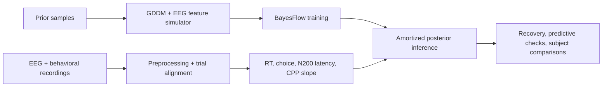

# GDDM + EEG: Simulation-Based Inference

**Joint modeling of reaction times, choices, and single-trial ERP features.**

Research code accompanying Jiaqi Xue's master's thesis at the **University of Copenhagen** (2025):

> **Towards the Integration of EEG and Behavioral Data in Decision Dynamics Modeling**  
> *A Simulation-Based Inference Framework Using GDDM and Single-Trial ERP Features*  
> Advisor: Alberto Parola · Submitted June 2, 2025

The project explores how N200 latency and centro-parietal positivity (CPP) slope can inform a generalized drift-diffusion model of decision making. PyDDM provides behavioral simulations; BayesFlow learns an amortized posterior using a DeepSet summary network and a CouplingFlow inference network. A behavior-only model provides the comparison.

[Model guide](docs/models.md) · [Setup & reproduction](docs/reproduction.md) · [Data format](docs/data.md) · [Notebooks](notebooks/README.md)

## Research workflow



The final joint model combines leaky accumulation, exponentially collapsing bounds, and simplified generative links to EEG features. Inference estimates a parameter vector for a subject's set of trials; the single-trial features do not imply a separate posterior parameter vector for every trial.

## Start here

| Goal | Entry point |
| --- | --- |
| Understand the final joint model | [`models/EEGGDDMfinal2.py`](models/EEGGDDMfinal2.py) |
| Inspect the behavior-only comparison | [`models/EEGGDDM_Behavonly2.py`](models/EEGGDDM_Behavonly2.py) |
| Explore posterior analyses | [Notebook guide](notebooks/README.md) |
| Find the original trained networks | [Checkpoint inventory](checkpoints_unified_joint/README.md) |
| Prepare an environment or adapt data | [Setup & reproduction](docs/reproduction.md), [data format](docs/data.md) |

## Repository layout

```text
.
├── models/                      # Joint and behavior-only model variants
├── analysis/                    # Recovery, predictive checks, and visualization
├── preprocessing/               # MATLAB / EEGLAB scripts
├── notebooks/                   # Original analysis notebooks and saved outputs
├── checkpoints_unified_joint/   # Four original .keras checkpoints
├── docs/                        # Model, data, and reproduction guides
├── CITATION.cff                  # Repository citation metadata
└── requirements.txt             # Python dependency inventory
```

Original script, notebook, and checkpoint filenames are retained within these directories. See the [old-to-new path map](docs/file-map.md) for links from the original flat layout.

## Models at a glance

| Script | Observations | Inferred parameters | Role |
| --- | --- | --- | --- |
| `EEGGDDMfinal2.py` | RT, choice, N200 latency, CPP slope | 8 | Final joint model identified in the original README |
| `EEGGDDM_Behavonly2.py` | RT, choice | 5 | Final behavior-only comparison |
| `EEGGDDMfinal.py` | RT, choice, N200 latency, CPP slope | 8 | Alternative non-decision-time prior |
| `EEGGDDM_Behavonly1.py` | RT, choice | 6 | Earlier comparison, also estimating starting bias |

The [model guide](docs/models.md) documents parameter order and priors directly from the scripts.

## Data and scope

The thesis considers value-based choices from [Pisauro et al. (2017)](https://doi.org/10.1038/ncomms15808) and perceptual choices from [Chen et al. (2022)](https://doi.org/10.1038/s41597-022-01538-5). Raw recordings and extracted feature tables are not bundled here. The MATLAB scripts cover parts of the second dataset's preprocessing; this repository does not contain a complete raw-data-to-features pipeline for both datasets.

This is the thesis research implementation. The directory cleanup preserves the original scientific files and saved notebook outputs. Reproducing an analysis requires external data, a compatible BayesFlow environment, and review of the historical paths and model/checkpoint pairing described in the [reproduction notes](docs/reproduction.md). Training and thesis results have not been rerun as part of this cleanup.

## Citation

If you build on the thesis, please cite:

```bibtex
@mastersthesis{xue2025eegbehavior,
  author = {Xue, Jiaqi},
  title = {Towards the Integration of EEG and Behavioral Data in Decision Dynamics Modeling: A Simulation-Based Inference Framework Using GDDM and Single-Trial ERP Features},
  school = {University of Copenhagen},
  year = {2025},
  month = jun,
  url = {https://github.com/ChristopherXMag/GDDM-SBI-SINGLETRIAL-EEG}
}
```

Repository metadata is also available in [`CITATION.cff`](CITATION.cff).
